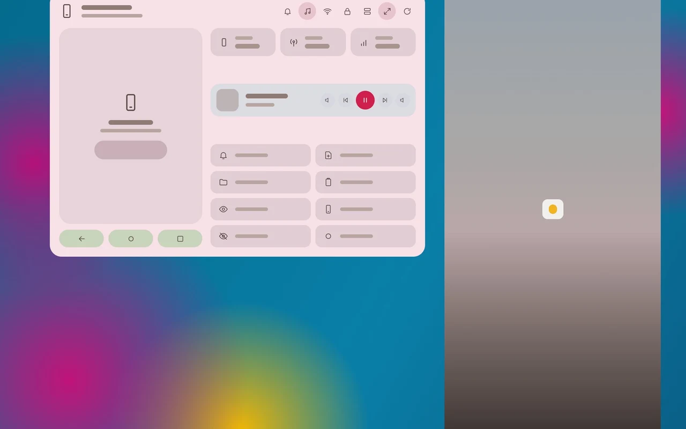

# iNiRConnect for iNiR

**iNiRConnect** is a native, multicompatible Android device management and companion plugin for the **iNiR** shell running on the **Niri** Wayland compositor.

It seamlessly bridges your Android device with your Linux desktop through a hybrid backend combining **ADB (Android Debug Bridge)** for low-latency device control and **KDE Connect** for rich background synchronization.

---

## Highlights

- **Dual-Engine Architecture**: Blends ADB and KDE Connect into a single unified telemetry and control hub.
- **Wireless ADB QR Pairing**: Instant wireless pairing using the standard AOSP barcode protocol (`WIFI:T:ADB;S:...;P:...;;`) with local mDNS advertisement.
- **Pixel-Perfect Screen Mirroring**: Integrated `scrcpy` launcher pre-configured with zero-letterboxing, optimal bitrate (12M), 60 FPS, and native Niri floating window placement.
- **Fluid Layout Morphing**: Dynamic transition between wide (horizontal 2-column) and compact (vertical 1-column) views with seamless container transforms and spring physics.
- **Windowed & Overlay Modes**: Switch on the fly between an overlay surface and a persistent floating Wayland window. Window preferences persist across sessions.
- **Multicompatible Family Design**: First-class support and styling across all three iNiR visual families:
  - **iRiS**: Island chassis joins, glass shaders, and spring-driven morphology.
  - **Material (ii)**: Material 3 container colors, expressive decel curves, and adaptive elevation.
  - **Waffle**: Compact geometry, unified border styling, and taskbar integration.
- **Comprehensive Phone Controls**:
  - Battery percentage & charge status
  - Network type (Wi-Fi / Cellular LTE/5G) and signal strength
  - Media player controls (play/pause, previous, next, volume) with live track and artist info
  - Remote ring / locate phone
  - Wake and unlock screen
  - Remote screenshot and screen recording triggered directly to desktop
  - Send files and browse phone filesystem
  - Clipboard sharing and custom notification dispatch

---

## Preview



---

## Prerequisites

To take full advantage of all features, ensure the following packages are installed on your system:

| Package | Purpose | Arch Linux | Fedora | Debian / Ubuntu | openSUSE |
| :--- | :--- | :--- | :--- | :--- | :--- |
| **android-tools** / **adb** | Wireless & USB ADB communication | `android-tools` | `android-tools` | `adb` | `android-tools` |
| **scrcpy** | Low-latency screen mirroring | `scrcpy` | `scrcpy` | `scrcpy` | `scrcpy` |
| **kdeconnect** | Telemetry, notification sync, media controls | `kdeconnect` | `kde-connect` | `kdeconnect` | `kdeconnect-kde` |
| **qrencode** | QR code generation for wireless pairing | `qrencode` | `qrencode` | `qrencode` | `qrencode` |
| **avahi** | mDNS zero-configuration discovery | `avahi` | `avahi` | `avahi-daemon` | `avahi` |

### Package Installation Commands

- **Arch Linux / Manjaro / CachyOS**:
  ```bash
  pacman -S android-tools scrcpy kdeconnect qrencode avahi
  ```

- **Fedora / RHEL**:
  ```bash
  dnf install android-tools scrcpy kde-connect qrencode avahi
  ```

- **Debian / Ubuntu / Linux Mint**:
  ```bash
  apt install adb scrcpy kdeconnect qrencode avahi-daemon
  ```

- **openSUSE (Tumbleweed / Leap)**:
  ```bash
  zypper install android-tools scrcpy kdeconnect-kde qrencode avahi
  ```

---

## Installation

### Manual Installation
Clone or copy this directory into your iNiR plugins folder:

```bash
mkdir -p ~/.local/share/inir/plugins/inirconnect
cp -r * ~/.local/share/inir/plugins/inirconnect/
```

Restart the iNiR shell to register the plugin:

```bash
inir restart
```

---

## Configuration & Niri Window Rules

For seamless floating window behavior, ensure the following rules exist in your `~/.config/niri/config.d/30-window-rules.kdl`:

```kdl
// Float iNiRConnect window
window-rule {
    match title="^iNiR AndroidConnect$"
    open-floating true
}

// Float scrcpy phone mirror without tiling bounds
window-rule {
    match app-id=r#"^(scrcpy|org\.genymobile\.scrcpy)$"#
    open-floating true
}
```

---

## Usage & Pairing

### 1. Wireless Pairing via QR Code
1. On your Android phone, enable **Developer Options** and open **Wireless Debugging**.
2. Tap **Pair device with QR code**.
3. In iNiRConnect, click the **Wi-Fi** icon in the header bar or select **Pair ADB for mirror** / **Wireless pairing**.
4. Scan the QR code displayed on your desktop. The plugin advertises the pairing service via mDNS and pairs automatically.
5. Once paired, the mirror and live ADB features will be activated immediately.

### 2. USB ADB
Simply connect your device via USB with USB Debugging enabled. iNiRConnect will auto-detect the serial and link the controls.

### 3. KDE Connect
Pair your device in KDE Connect as usual. The plugin automatically reads device status, battery level, network type, media, and quick actions.

---

## IPC Commands & Shortcuts

You can control iNiRConnect from terminal scripts, shell shortcuts, or Niri keybindings using `inir ipc`:

```bash
# Toggle panel visibility
inir ipc inirconnect toggle

# Open or close explicitly
inir ipc inirconnect open
inir ipc inirconnect close

# Toggle between Overlay and Windowed mode
inir ipc inirconnect windowed

# Toggle between Horizontal and Vertical layouts
inir ipc inirconnect layout

# Launch phone screen mirror (scrcpy)
inir ipc inirconnect mirror

# Refresh connected devices
inir ipc inirconnect refresh

# Open specific sheets ("wireless", "notifications", "devices")
inir ipc inirconnect sheet wireless
```

### Adding Keybindings to Niri

Add to `~/.config/niri/config.d/70-binds.kdl`:

```kdl
// Toggle iNiRConnect with Super+A
Mod+A { spawn "inir" "ipc" "inirconnect" "toggle"; }

// Quick Mirror with Super+Shift+A
Mod+Shift+A { spawn "inir" "ipc" "inirconnect" "mirror"; }
```

---

## Architecture & File Structure

```
inirconnect/
├── assets/                  # Icons and preview mockups
│   ├── preview.png          # High-resolution Hub preview banner
│   ├── icon-dark.svg        # Adaptive dark launcher icon
│   └── icon-light.svg       # Adaptive light launcher icon
├── components/              # Reusable UI modules
│   ├── DeviceSheet.qml      # Device selector & connection manager
│   ├── HeaderBar.qml        # Status badge, quick toggles & layout actions
│   ├── MediaCard.qml        # Album art & media playback controls
│   ├── NotificationsSheet.qml # Synced Android notifications view
│   ├── PhoneMirror.qml      # Phone card, scrcpy launcher & nav buttons
│   ├── QuickActions.qml     # 10 device actions (ring, files, screenshot, etc.)
│   ├── StatusCards.qml      # Telemetry cards (Battery, Network, Signal)
│   └── WirelessSheet.qml    # Wireless pairing guide & QR code generator
├── scripts/
│   └── adb_qr_service.py    # AOSP QR generator + avahi mDNS pairing daemon
├── state/
│   └── AndroidState.qml     # Unified reactive backend & IPC coordinator
├── translations/
│   ├── en_US.json           # English localization
│   └── es_419.json          # Spanish localization
├── views/
│   ├── IrisView.qml         # iRiS family surface implementation
│   ├── MaterialView.qml     # Material (ii) family surface implementation
│   └── WaffleView.qml       # Waffle family surface implementation
├── Panel.qml                # Root Scope, window host & IPC handler
├── choices.sh               # Hub options script (pin to dock, default mode)
├── hub-index.json           # Community Hub metadata registry
└── plugin.json              # iNiR plugin manifest
```

---

## License

This project is licensed under the **MIT License**. Created by [ltar](https://github.com/ltar) for the **iNiR** shell ecosystem.
