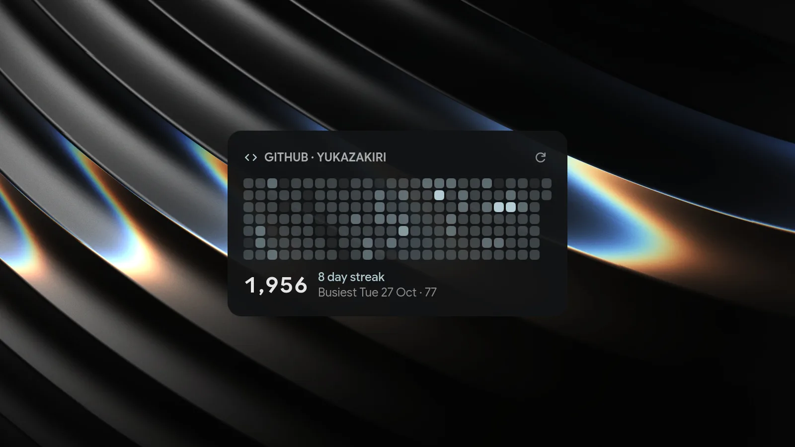
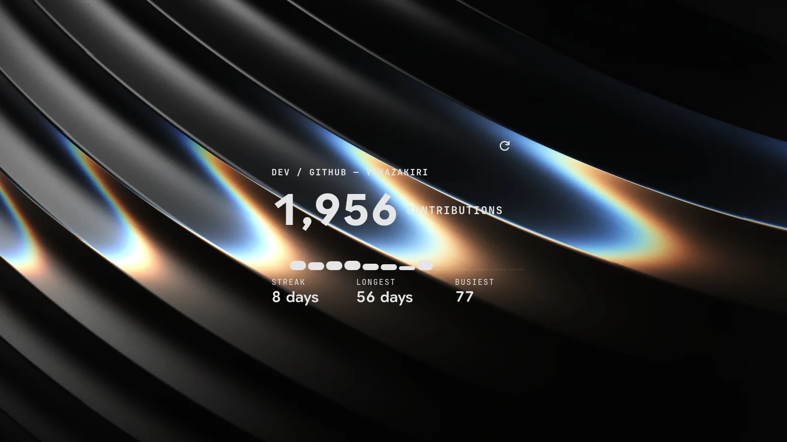
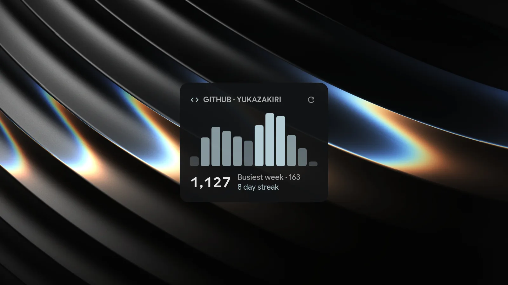
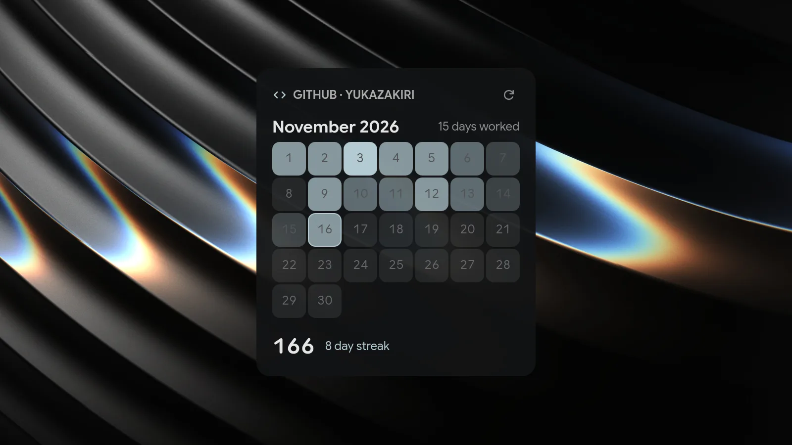
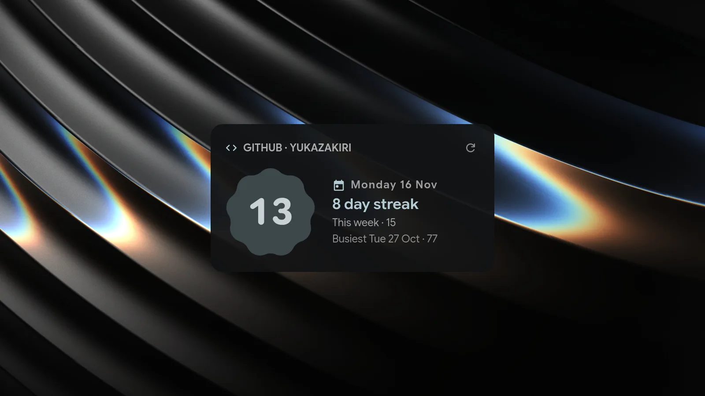

# Dev Stats

Your contribution graph on the desktop. GitHub, GitLab and Forgejo (Codeberg, Gitea) contributions as
weeks of squares, with the total, the streak that is still going and the busiest day under them.

| Family | Where it shows | How to add it |
| --- | --- | --- |
| Material | A card on the desktop | Edit the desktop, add a widget, Dev Stats |
| Material sidebars | A card in the left sidebar's Widgets column; a tab of the right sidebar | The card shows once installed (Settings › Panels › Widgets hides it); the tab: Settings › Sidebars › Right sidebar, Dev Stats |
| iRiS | A line on the Island's Desktop page | The Island's Desktop page, add, Dev Stats |
| Waffle | A card in the Widgets panel | It shows in the panel once installed |

## Your accounts

It shows the account your own command line tools are already logged in to: `gh` for GitHub, `glab`
for GitLab, `tea` for Forgejo, Gitea and Codeberg. There is no token to paste and no token is read.

With **Find my gh and glab accounts** on, it takes the first account it finds. To name one yourself,
put it in **Account** as `host/user`:

```
github.com/you
codeberg.org/you
gitlab.example.com/you
forgejo:git.example.org/you
```

The platform is read from the host — `github.com`, `gitlab.com`, anything else Forgejo — and a
`github:`, `gitlab:` or `forgejo:` in front says so instead.

## Settings

| Setting | What it changes |
| --- | --- |
| Account | `host/user`, or empty for the first account `gh` or `glab` is logged in to |
| Find my gh and glab accounts | Ask those two tools who they are logged in as |
| Weeks shown | 4 to 53 weeks of squares. Default 26 |
| Total and streak | The figures under the grid |
| Refresh every | Minutes between fetches, 5 to 240, and only while the widget is on screen. Default 30 |
| Look | Squares, Instrument, Bars, Month or Today |

## The five looks

Every look reads the same numbers, so the choice is only about how the work reads best to you.

### Squares



The weeks as a grid, five steps of the accent from quiet to busy, the numbers under it. Hovering a square names the
day; a click fetches again.

### Instrument



The iNstrument grammar the built-in widgets wear: an eyebrow, the total as the reading, the last two weeks measured,
and the streak, longest run and busiest day as fields. It is also what every face draws when the desktop's widget
design is iNstrument or Readout.

### Bars



The last twelve weeks as columns: which weeks were heavy, which were quiet, and where the run the streak is made of
sits.

### Month



This calendar month as a sheet of days, each one shaded by what it holds and today outlined. The footer says how much
the month has added so far.

### Today



Today's count in a Material shape — the shape grammar of the built-in widgets — beside the week so far, the streak and
the busiest day.

On the desktop card, hovering a square names its day and how much you did; the arrow at the top right
fetches again by hand.

## What it reaches

It runs `jq` plus your own `gh`, `glab` or `curl`, which talk to your GitHub, GitLab or Forgejo
account with the login you already gave them. Nothing else on the computer is read, and the numbers are
kept in memory only.

## For makers

`dev-stats.sh` finds the accounts and fetches one; `stats.js` turns a year of days into the weeks, the levels, the
streak, the month sheet and today; `DevStatsStore.qml` is the one state every face reads. The card holds the plate, the
account line and the words of every empty state, and each look is its own file: `LookGrid.qml`, `LookInstrument.qml`,
`LookWeeks.qml`, `LookMonth.qml`, `LookToday.qml`. The other faces — `SidebarDevStats.qml`, `IrisDevStats.qml` and
`WaffleDevStats.qml` — lay the same numbers out with their family's parts.
