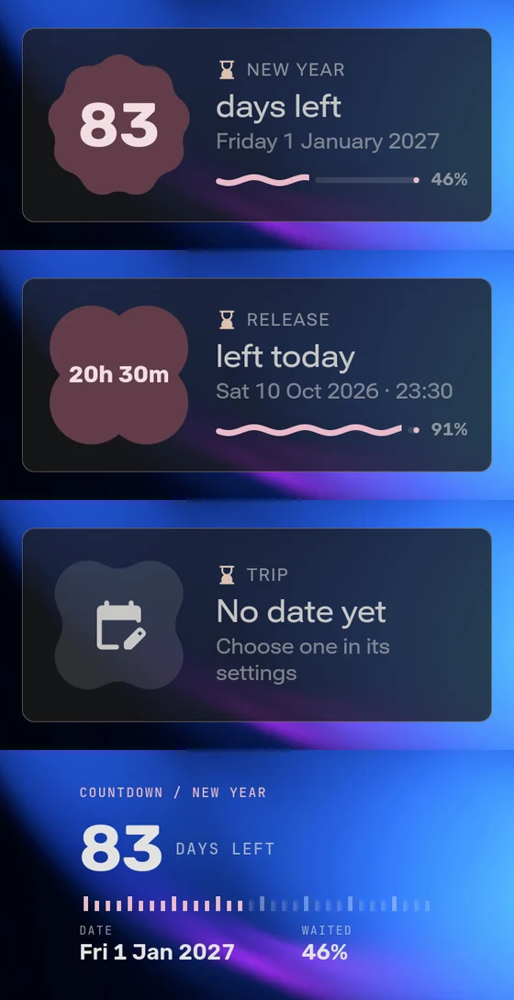
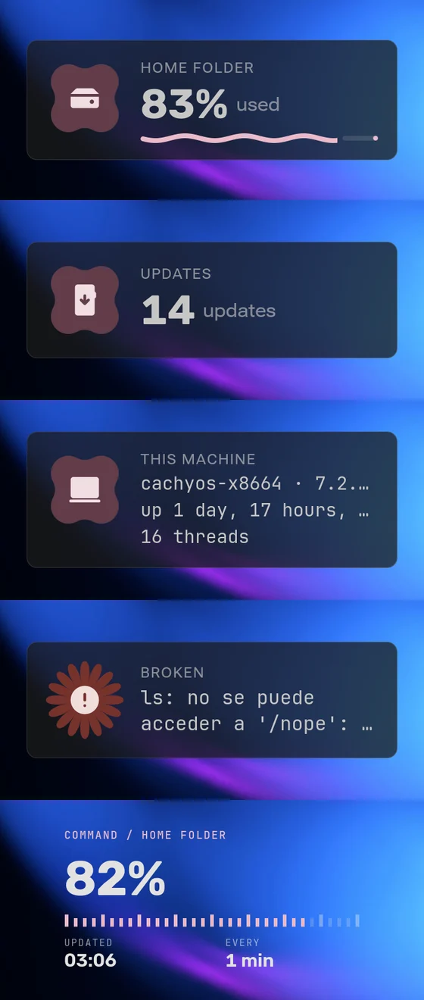

# Material widgets

How to make a desktop widget that looks like it shipped with iNiR. Read it with
[`widgets/countdown/Countdown.qml`](../widgets/countdown/Countdown.qml) open beside it: every rule here is used there.
`inir hub new widget <id>` starts you from a template built the same way.



## The bar

A widget in the Hub sits on someone's desktop next to the built-in ones. If it reads as a label and a number on a grey
box, it looks broken beside them. Use what the shell gives you:

| Piece | Import | What it is for |
| --- | --- | --- |
| `MaterialShape` | `qs.modules.common.widgets` | 35 Material 3 shapes (cookies, bursts, clovers, gems). Change `shape` and it morphs with a spring. Hold your glyph or figure in one. |
| `DesktopWidgetShapes.shapeForName()` | `qs.modules.background.widgets` | The shape names the user picks from, so your setting matches the built-ins' |
| `WidgetShapePicker` | `qs.modules.background.widgets` | The shape grid for your quick controls |
| `StyledProgressBar { wavy: true }` | `qs.modules.common.widgets` | The Material 3 wavy bar, for a bounded value (a wait, a percentage). Keep `animateWave: false` on the desktop. |
| `WidgetSurface` | `qs.modules.background.widgets` | The plate every built-in sits on: the user's opacity, outline, blur and corners reach your widget through it |
| `InstrumentLabel`, `InstrumentField`, `InstrumentScale` | `qs.modules.background.widgets.instrument` | The iNstrument look: monospace eyebrow, labelled fields, a measured scale |
| `WidgetQuickSection`, `WidgetQuickChoices`, `WidgetQuickToggle`, `WidgetQuickSlider` | `qs.modules.background.widgets` | Quick controls in edit mode, in `editPopoverContent` |
| `MaterialSymbol` | `qs.modules.common.widgets` | Icons. `fill: 1` for a solid glyph. |

## Two looks, and the user's design

Built-in widgets offer a look of their own and an iNstrument look. Users can also pick one design for every widget
(Settings › Widgets). Yours follows it:

```qml
readonly property bool instrument: root.widgetSharedDesign === "instrument" || root.widgetSharedDesign === "readout"
    || String(root._readConfigKey("style") ?? "shape") === "instrument"
widgetSurfaceEnabled: !root.instrument   // iNstrument is borderless
```

Draw both bodies and cross-fade them on `instrument` with `opacity` and `visible: opacity > 0`. Picking a style in
your quick controls (`root._setOutputValue("style", value)`) makes the widget an exception to the global design on
its own; you don't have to handle that.

**iNstrument rules.** The eyebrow is `Channel / Detail` in `InstrumentLabel`, in the accent. The figure uses
`root.widgetNumbersFamily`, Bold, `font.features: ({ "tnum": 1 })`, `letterSpacing: -1`. A bounded value goes on
`InstrumentScale`; never draw a ring for something that is not cyclic. Supporting facts go in `InstrumentField`s.

## Colour

Never a hex value. The user's palette and theme reach the widget through these:

| Use | Property |
| --- | --- |
| Text and lines over the wallpaper or plate | `root.widgetInk` (set `needsColText: true`) |
| Secondary text | `ColorUtils.applyAlpha(root.widgetInk, 0.58)` to `0.66`, or `root.widgetInkMuted` |
| A tint that has to read on the backdrop (bar, glyph, eyebrow) | `root.widgetAccentVisible`, `root.widgetAccent3Visible` |
| A shape's fill and what sits on it | `root.widgetSemanticContainer(role)` and `root.widgetSemanticOnContainer(role)` with `root.widgetPrimaryRole`, `widgetSecondaryRole`, `widgetTertiaryRole` |
| Something wrong | `root.widgetSemanticForeground(root.widgetSignalRole)`; for a filled shape, `Appearance.colors.colErrorContainer` and `colOnErrorContainer` |
| Tracks and hairlines | `ColorUtils.applyAlpha(root.widgetInk, 0.16)` |

Give each state its own role, so the state reads before the words do: Countdown is primary while it waits,
tertiary on the day, secondary once it has passed.

## Type and size

Three levels, never more: an **eyebrow** (`Appearance.font.pixelSize.smaller`, DemiBold,
`font.capitalization: root.widgetCapitalization`, letter spacing 1, ink at 0.66), the **figure** (numbers family, Bold,
tabular), and a **detail** line (`pixelSize.small`, ink at 0.58). A title beside a figure uses `root.widgetTitleFamily`,
`widgetTitleWeight`, `widgetTitleTracking` and `pixelSize.huge * widgetTitleScale`, so Editorial and iRiS designs
restyle it.

Every size and gap is a number times `root.scaleFactor`, rounded: `Math.round(16 * root.scaleFactor)`. The user
resizes with `resizableAxes: ({ uniform: "widgetScale" })`; nothing else is needed.

## Long text

People run iNiR in 18 languages and write their own labels. Plan for it:

- Give the text column a width (`root.infoWidth`) and the card a width from it. Never let a label grow the card.
- Every line that holds data or a user's words gets `elide: Text.ElideRight` and `Layout.fillWidth: true`.
- A figure inside a shape uses `fontSizeMode: Text.Fit` with a `minimumPixelSize`, so "11h 40m" shrinks instead of
  spilling.
- A hint (an empty or failed state) may wrap: `wrapMode: Text.WordWrap`, `maximumLineCount: 2`.
- Test with a label half again as long as yours, and with the longest real value (a date with time, a full error).
- A default state never shows truncated data. If the date elides at the default size, use a shorter format.

## States

Each one is designed, with a next step, never a blank card:

| State | Countdown | Shell Line |
| --- | --- | --- |
| Not set | Neutral cookie with `edit_calendar`, "No date yet", where to set it | "Choose a command in its settings" |
| Working | (none) | The shape gives one spring per run; "Running…" before the first answer |
| Failed | (none) | Error-coloured burst, what the command printed |
| Done | Burst in the tertiary role with `celebration` | (none) |

Morphing the shape between states costs nothing and says more than any badge.



## Cost

The desktop is redrawn whole for anything that moves on it.

- Nothing loops for decoration: no spinning, pulsing or flowing wave at rest. A short spring when something changes
  is fine.
- Clocks tick by the minute when that is enough (`SystemClock { precision: SystemClock.Minutes; enabled: root.visible }`).
- Timers and processes run while `root.visible && root.motionActive` (not behind windows), with one exception: the
  first run happens anyway, so a widget added behind a window is not stuck on "Running…".
- One `Process`, reused. Never start a run while the last one is going.
- Logic shared by the iRiS and Waffle faces lives in one `.js` file (`countdown.js`, `shellline.js`).

## Never

- Hex colours, `Qt.rgba` literals, hand-picked font sizes outside the ladder.
- Shadows, gradients and glass of your own: `WidgetSurface` already draws the user's material.
- A `Rectangle` and a `Text` dressed up as a button or chip: use the shell's controls.
- Text that runs past the card at any length, in any language.
- A single look that ignores the user's widget design.

## The preview

The Hub card is your widget on a real wallpaper, framed the same way for every item:

```sh
# 1. Install it, put it on the desktop, set it to 200 % in edit mode, in the state worth showing.
# 2. Shoot it (offscreen, your windows stay where they are) and frame it on a wallpaper you choose:
inir background widgetSnapshot custom.my-widget /tmp/shot.png
inir hub preview widgets/my-widget --wallpaper ~/Pictures/calm-wallpaper.jpg --shot /tmp/shot.png --side left
```

Pick a wallpaper with a calm area where the widget sits and a focal point it leaves free. Look at the result at card
size before you commit it.

## Before the pull request

- [ ] Both looks, and the global iNstrument and Readout designs, look right
- [ ] Dark and light scheme, plate on and off, two different wallpapers
- [ ] Every state seen: not set, working, failed, done
- [ ] A label 50 % longer and the longest real value stay inside the card
- [ ] 100 % and 200 % scale
- [ ] Quick controls change what they say
- [ ] `inir hub validate widgets/<id>` passes
- [ ] The preview reads at card size
