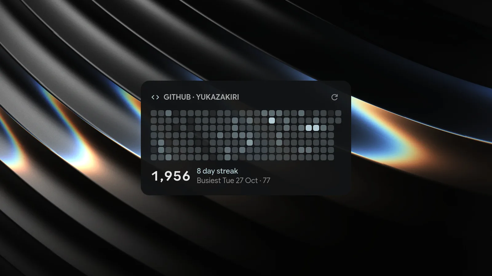
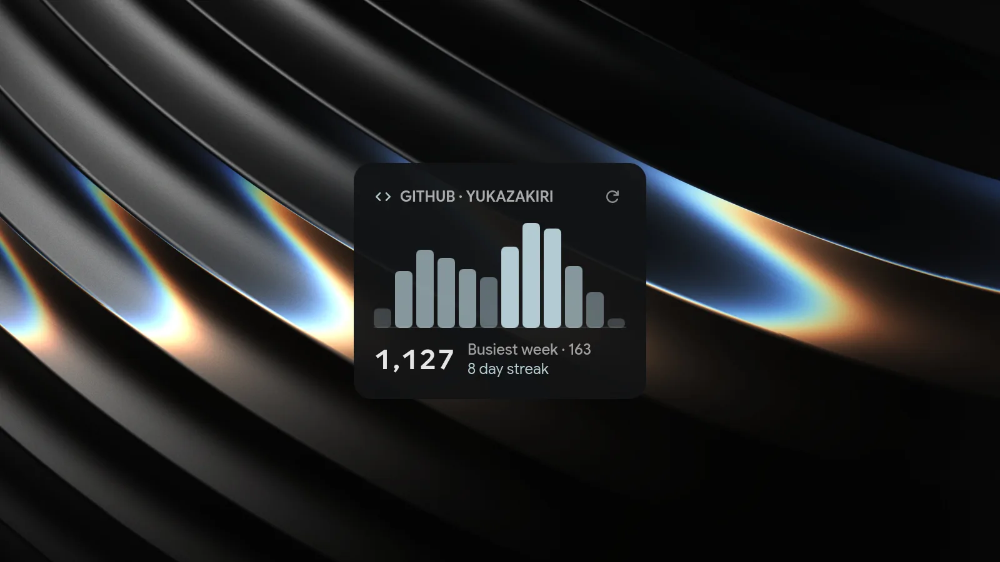
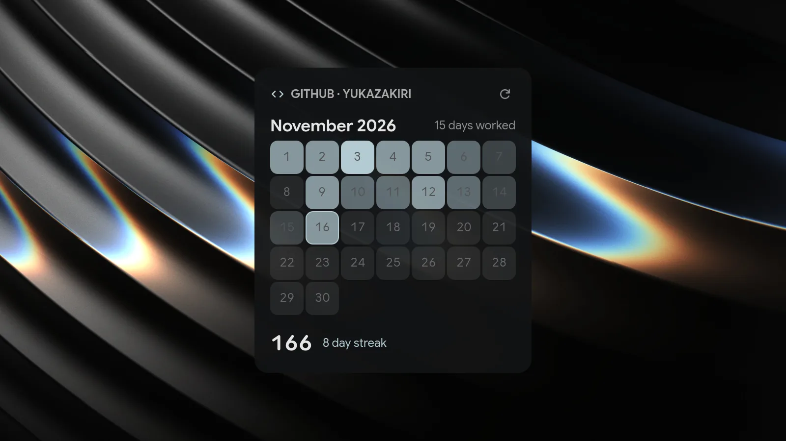
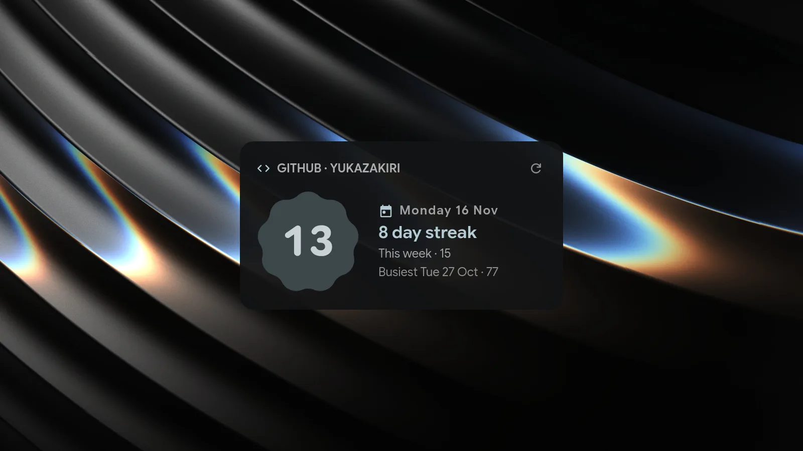

# Dev Stats

Your contribution graph on the desktop, with a face for every family.


The last weeks of your GitHub, GitLab or Forgejo (Codeberg, Gitea) contributions sit on the desktop as
squares: quiet days in the wallpaper's ink, busy ones in the accent, and the busiest day in the mix
darkest. Under them are the total, the streak that is still going and the busiest day. Hover a square
and the line under the grid says which day it is and how much you did.

| Family | Where it shows |
| --- | --- |
| Material | A card on the desktop: weeks of squares, the numbers under them, and an Instrument look |
| Material sidebars | A card in the left sidebar's Widgets column; a tab of the right sidebar once you turn it on in Settings › Sidebars |
| iRiS | A line on the Island's Desktop page: the last two weeks as small squares and your streak |
| Waffle | A card in the Widgets panel: the last ten weeks and the total |

## Your accounts

Dev Stats never asks for a token and never reads one. It shows the accounts your own command line
tools are already logged in to:

| Platform | Its tool | Log in once |
| --- | --- | --- |
| GitHub (and GitHub Enterprise) | `gh` | `gh auth login` |
| GitLab (and self-hosted GitLab) | `glab` | `glab auth login` |
| Forgejo, Gitea, Codeberg | `tea`, or nothing | `tea login add` for discovery, or type the account |

`jq` reads the answers, and `curl` fetches a Forgejo heatmap; both come with every distro iNiR runs
on. Only the tools of the platforms you use are needed: with `gh` alone you get GitHub.

With **Find my gh and glab accounts** on, the first account it finds is the one shown, and it moves to
another as soon as you say so. To name one yourself, put it in **Account**:

```
github.com/you
codeberg.org/you
gitlab.example.com/you
forgejo:git.example.org/you
```

The host comes first, then the user. The platform is read from the host: `github.com` is GitHub,
`gitlab.com` is GitLab, anything else is Forgejo — say `github:`, `gitlab:` or `forgejo:` in front when
that is wrong, as in `gitlab:code.example.org/you`.

## Settings

| Setting | What it changes |
| --- | --- |
| Account | `host/user`, or empty to use the first account `gh` or `glab` is logged in to |
| Find my gh and glab accounts | Ask those two tools who they are logged in as |
| Weeks shown | How far back the squares go: 4 to 53 weeks. Default 26 |
| Total and streak | The figures under the grid |
| Refresh every | Minutes between fetches, 5 to 240. Default 30. Only while the widget is on screen |
| Look | One of the five below |

## The five looks

| Look | What it draws |
| --- | --- |
| Squares | The weeks as a grid of squares, the numbers under them. Hover a day to read it |
| Instrument | The iNstrument grammar: an eyebrow, the total as the reading, the last two weeks measured, labelled fields |
| Bars | The last twelve weeks as columns, so the rhythm of the work reads at a glance |
| Month | This calendar month as a sheet, each day shaded by what it holds, today outlined |
| Today | Today's count in a Material shape, beside the week so far, the streak and the busiest day |

| | |
| --- | --- |
|  |  |
|  |  |



The person's global widget design wins over the setting: with iNstrument or Readout chosen for the desktop, every
face draws the Instrument look.

Changing the account or the width asks for the numbers again. The refresh arrow at the top right of
the card fetches by hand; a click on the squares does the same.

## What it runs, and what it reaches

It runs one helper script from its own folder, which in turn runs `gh`, `glab` or `curl` — the tools
you already use, with the logins you already gave them. It reads nothing else on your computer and
writes nothing: the numbers stay in memory and are fetched again when the shell starts. Your hosts are
the ones your tools are set up for; `github.com`, `gitlab.com` and `codeberg.org` are what people
usually use, and self-hosted GitLab or Forgejo instances are reached at their own address.

## If it shows nothing

| The card says | What it means |
| --- | --- |
| Add an account | No `gh` or `glab` login was found, and no account is typed in Settings |
| That account does not look like host/user | The Account field wants `host/user`, not a URL or a name alone |
| This platform's command line tool is not installed | Install `gh`, `glab` or nothing (`curl` does Forgejo) |
| The platform did not answer | The network, the login, or the instance is down. Try the refresh arrow |
| Dev Stats needs jq | Install `jq` |

The hub's audit holds this item to what it declares: `process` (it runs the tools) and `network` (they
fetch your calendar).
